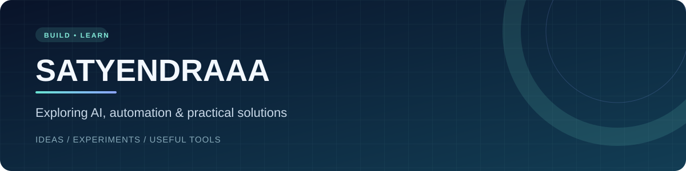

  

<h1 align="center">Hi, I'm SatyendrAAA 👋</h1>

<strong>Curious about AI agents, automation &amp; tools that make everyday work easier.</strong>

  <a href="https://github.com/SatyendrAAA?tab=repositories">Explore projects</a> ·
  <a href="https://github.com/SatyendrAAA/spoilertech/issues/new?template=project-inquiry.yml">Discuss a project</a> ·
  <a href="https://github.com/SatyendrAAA">GitHub profile</a>

---

## A little about me

I'm building my GitHub presence around practical ideas and learning in public. My focus is on exploring how simple tools and automation can save time, make data easier to work with, and turn a clear problem into a useful solution.

**Currently exploring:** Python · CSV data cleanup · automation · AI agent concepts

## Selected work

### 🧹 [CSV Cleaner](https://github.com/SatyendrAAA/spoilertech/tree/main/portfolio/csv-cleaner)

A small, dependency-free Python tool that trims CSV data, removes exact duplicates and keeps the original file untouched. Includes a sample dataset and automated tests.

**Good for exploring:** data preparation, repetitive cleanup and command-line workflows. [See the project →](https://github.com/SatyendrAAA/spoilertech/tree/main/portfolio/csv-cleaner)

### 🤖 [my_agent](https://github.com/SatyendrAAA/my_agent)

An early-stage project described as an AI agent skeleton for browser automation and memory. It is a starting point, not a finished product. [View the repository →](https://github.com/SatyendrAAA/my_agent)

## Ideas we can discuss

Have a small, well-defined problem? I'm interested in conversations around:

- Cleaning or organizing simple CSV data.
- Exploring ways to automate repetitive digital tasks.
- Early-stage AI agent ideas and practical experiments.

The right approach depends on the requirements. Let's discuss the scope and feasibility before making commitments.

## Let's connect

[**Start a project inquiry →**](https://github.com/SatyendrAAA/spoilertech/issues/new?template=project-inquiry.yml)

Share a brief, non-confidential description of the problem, the outcome you want and your preferred timeline. GitHub issues are **public**: never post passwords, private customer data, payment details or confidential files. If the inquiry template isn't available yet, you can [open a regular issue](https://github.com/SatyendrAAA/spoilertech/issues/new) instead.

---

Learning in public, one useful project at a time.
